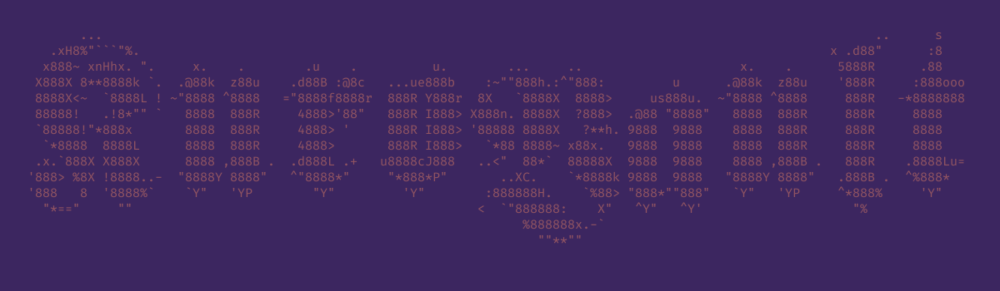

# KuroVault

**High-throughput, multi-tenant AI knowledge vault built with FastAPI, pgvector, and Redis. Features hybrid RRF retrieval, sub-50ms semantic caching, self-correcting multi-agent orchestration, and real-time SSE streaming.**

---

## Requirements Checklist

### 1. Multi-Tenant Knowledge Base & Ingestion
- [ ] **Content-Addressable Deduplication:** Hash uploaded files (`SHA-256`) scoped per `tenant_id`; return existing `document_id` (`200 OK`) immediately on duplicates.
- [ ] **Structure-Aware Parent-Child Chunking:** Parse PDFs, Markdown, and CSVs preserving metadata (`page_number`, `section_header`, `row_range`). Embed 256-token child chunks while returning 1,024-token parent blocks for synthesis.
- [ ] **Priority Worker Queues:** Isolate bulk background uploads (`low_priority`) from urgent single-doc syncs (`high_priority`) via `ARQ` / `Taskiq` so large uploads never stall live chat latency.
- [ ] **Strict Tenant Isolation:** Enforce `tenant_id` filtering across vector indexes, full-text queries, and Redis cache namespaces (zero cross-tenant leaks).

### 2. Hybrid Retrieval Engine (`pgvector` + BM25 + RRF)
- [ ] **Dense Vector Search:** `pgvector` HNSW index using cosine distance (`<=>`) on `halfvec(1536)` embeddings.
- [ ] **Sparse Lexical Search:** PostgreSQL native `tsvector` + GIN index using `ts_rank_cd` for exact keyword/code matching.
- [ ] **Reciprocal Rank Fusion (RRF):** Merge dense and sparse rankings ($k = 60$) for conceptual + exact identifier recall.

### 3. Semantic Cache with Epoch Invalidation
- [ ] **Sub-50ms Cache Hits:** Embed incoming queries and search Redis Stack for past tenant queries with `cosine_similarity >= 0.94`, streaming cached answers + citations immediately without invoking an LLM.
- [ ] **Automatic Cache Invalidation:** Increment per-tenant `cache_epoch` in PostgreSQL whenever documents are uploaded, modified, or deleted to instantly invalidate stale entries.

### 4. Multi-Agent Orchestration & Self-Correction
- [ ] **Router Agent:** Classify query intent (`SIMPLE_LOOKUP`, `MULTI_HOP_SYNTHESIS`, `TABULAR_AGGREGATION`, `OUT_OF_SCOPE`) and decompose complex queries into parallel sub-tasks.
- [ ] **Parallel Retriever Agents:** Execute sub-queries concurrently (`asyncio.gather`) across document chunks and CSV records.
- [ ] **Critic / Grounding Verifier Agent:** Grade retrieved chunks for relevance; trigger a **1x Self-Correction Loop** (rewrite query and retry retrieval) if confidence is low, refusing to hallucinate when evidence is missing.
- [ ] **Citation Synthesizer Agent:** Stream grounded answers with inline, verifiable `[chunk_id]` citations mapped to exact source spans.

### 5. Real-Time SSE Streaming & Resilience
- [ ] **Typed SSE Event Protocol:** Emit structured JSON events (`status`, `sources`, `token`, `done`) with `X-Accel-Buffering: no` and periodic `: keepalive` frames.
- [ ] **Zombie Stream Cancellation:** Monitor `await request.is_disconnected()` mid-stream to abort in-flight LLM calls immediately, wrapping post-stream telemetry writes in `asyncio.shield()`.
- [ ] **Execution Trace Auditing:** Persist full `query_traces` (TTFT, total latency, cache hit/miss, agent hops, cited chunk IDs).
- [ ] **Rate-Limit & Retry Hardening:** Batch embeddings in groups of 64 with `tenacity` exponential backoff and Redis sliding-window rate limiting (`slowapi`).

### 6. Acceptance & Load Criteria
- [ ] **Zero Cross-Tenant Leaks:** Integration tests verify Tenant A cannot access Tenant B's chunks or semantic cache.
- [ ] **Sub-50ms Semantic Cache:** Semantically equivalent queries (`>= 0.94` similarity) bypass LLM execution completely.
- [ ] **Backpressure Stability:** Sustains `50+` concurrent SSE streams while ingesting large multi-page PDFs in the background without dropped connections.
- [ ] **Zero Hallucination Fallback:** Out-of-scope queries trigger the Critic's self-correction loop and cleanly decline when grounded evidence is absent.

---

## Author

- [@Yenterick](https://github.com/Yenterick)

## License

This project is licensed under the MIT License — see the [LICENSE](./LICENSE) file for details.
